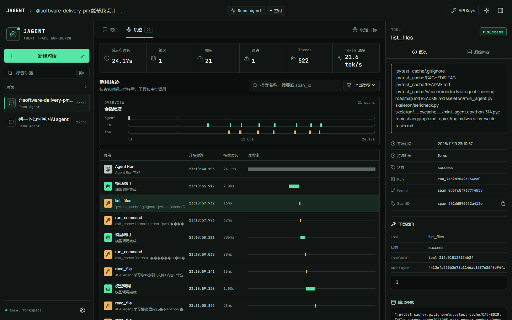
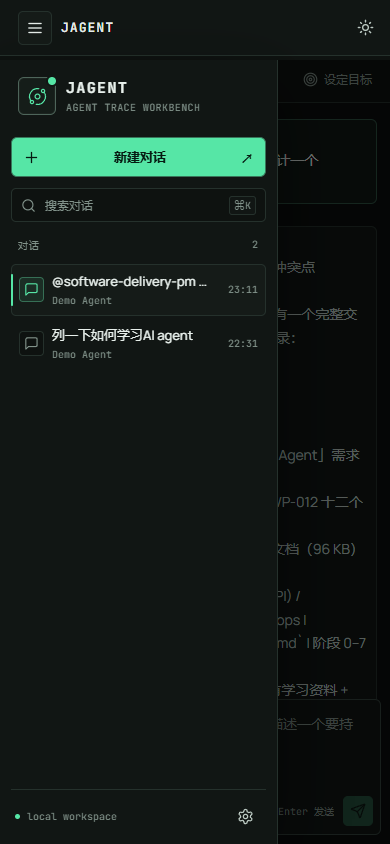
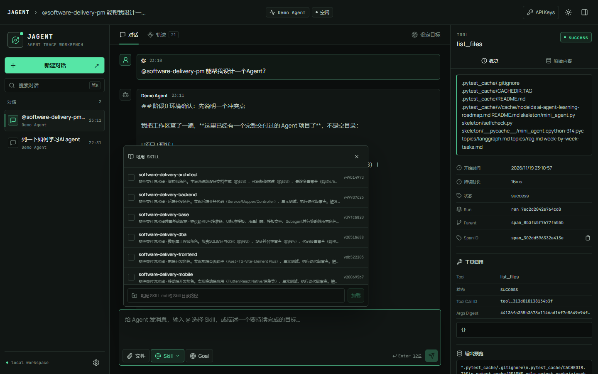

# AgentShow

AgentShow 是一个本地优先的通用 Agent 工作台，目标接近 DeepSeek Harness。

当前已经生成可运行实现、示例轨迹、桌面与移动截图。

## 快速运行

```powershell
cd AgentShow
.\run.ps1
```

或者：

```powershell
cd AgentShow\deliverables\backend
python -m uvicorn app.main:app --host 127.0.0.1 --port 8000
```

打开 `http://127.0.0.1:8000`。

运行和依赖说明见 [deliverables/README.md](deliverables/README.md)。
实现说明见 [docs/solution-summary.md](docs/solution-summary.md)。
演示截图见 `screenshots/`。

## 测试

```powershell
cd test
.\run-tests.ps1
```

测试包含后端 Pytest、80% 覆盖率门禁、Agent Host 构建、前端构建和 Playwright E2E。
报告输出到 `test/reports/`。

它同时承担两类目标：

1. 完整 Agent 能力：对话、模型管理、API Key、工具、Skill、Context、Memory 和会话恢复。
2. 作业五能力：将一次真实 Agent 对话转换为可读的轨迹图，展示总时长、轮次、调用开始时间、持续时长和内容摘要。

当前仓库包含完整设计文档与可运行实现（`deliverables/`），示例会话与演示数据可直接在本地启动验证。

## 架构

```text
Vue 3 前端
    |
    | REST + WebSocket
    v
FastAPI 控制平面
  ├─ Session Service
  ├─ LLM Gateway
  ├─ API Key Vault
  ├─ Tool / Skill / Memory
  ├─ Trace Service
  └─ Pi Process Manager
          |
          | JSONL RPC
          v
Pi Agent Sidecar
  ├─ Agent Loop
  ├─ Session Tree
  ├─ Context
  ├─ Skill Discovery
  └─ Tool Calls
          |
          | 内网 OpenAI-compatible API
          v
FastAPI LLM Gateway
          |
          v
DeepSeek / OpenAI / OpenRouter / Ollama / 自定义端点
```

## 技术栈

| 层 | 技术 |
|---|---|
| 前端 | Vue 3、TypeScript、Vite、Pinia、Element Plus |
| 控制平面 | Python 3.12、FastAPI、Pydantic、SQLAlchemy、Alembic |
| Agent 引擎 | Node.js 22、`@earendil-works/pi-coding-agent` |
| 通信 | REST、WebSocket、Pi JSONL RPC |
| 数据库 | SQLite，WAL 模式 |
| 密钥 | OS Keyring + AES-GCM/Fernet |
| 测试 | Pytest、Vitest、Playwright |

## 核心设计

- Pi 负责 Agent Loop、Session Tree、Context 和 Skill 发现。
- FastAPI 负责模型统一网关、API Key、工具授权、审批、持久化和事件流。
- Pi 不持有上游 Provider 密钥。
- 所有模型请求经过 FastAPI。
- 所有工具调用经过统一校验、权限、审批和审计。
- Skill 使用 Agent Skills 标准目录。
- Context 使用 Pi 活动分支和 compaction。
- Memory 采用 OKF Markdown + SQLite 投影。
- Trace 从真实 Pi 事件生成，不使用伪造演示事件代替运行轨迹。

## 目录

```text
AgentShow/
├─ README.md
├─ requirements/
│  ├─ 01-assignment-requirements.md
│  └─ 02-full-agent-requirements.md
├─ design/
│  ├─ full-agent/
│  │  ├─ 00-reference-assessment.md
│  │  ├─ 01-product-design.md
│  │  ├─ 02-system-architecture.md
│  │  ├─ 02A-goal-loop.md
│  │  ├─ 03-pi-agent-runtime.md
│  │  ├─ 04-llm-gateway-and-key-vault.md
│  │  ├─ 05-fastapi-contracts.md
│  │  ├─ 06-tools-skills-context-memory.md
│  │  ├─ 07-sessions-traces-and-storage.md
│  │  ├─ 08-frontend-workspace.md
│  │  ├─ 09-security-and-deployment.md
│  │  ├─ 10-implementation-plan.md
│  │  ├─ 11-skill-lifecycle.md
│  │  └─ 12-single-agent-evaluation.md
│  └─ 早期纯前端轨迹查看器设计
├─ plans/
│  └─ full-agent/
│     ├─ WP-001 ... WP-012
│     └─ TASK-101-full-agent-delivery.md
├─ check/
│  ├─ 00-env/
│  ├─ 01-full-agent-requirements.md
│  ├─ 01-rules-extracted.md
│  └─ 02-design.md
└─ test/
   ├─ e2e/
   ├─ reports/
   ├─ run-tests.ps1
   └─ README.md
```

`design/full-agent/` 是当前权威设计。`design/` 根目录下的早期纯前端方案只作为轨迹 UI 参考。

## 完整 Agent 能力

- 多会话对话和流式回答。
- 会话恢复、中止、steer 和 follow-up。
- 同一对话可持续多次交流。
- 指定目标后自动迭代，直到完成标准通过。
- Provider、Model 和 API Key 管理。
- API Key 加密存储、连接测试、轮换和删除。
- DeepSeek、OpenAI-compatible、OpenRouter、Ollama 等模型。
- 文件、搜索、patch、命令和 Git 工具。
- Word、Markdown、PDF 和文本文件导入。
- 助手回答可导出 Markdown、Word 和 PDF。
- Pi Agent 支持 `web_search` 和 `web_fetch` 网络检索。
- 工具权限、沙箱、审批、取消和审计。
- Agent Skills 渐进加载和项目信任。
- Skill 版本、所有权、加载验证和变更回归。
- 内置 10 个 `software-delivery` Skill。
- 支持 Skill 选择器、`@skill-name` 提及和 Skill 路径加载。
- Pi Session Tree 和 Context compaction。
- 短期会话记忆和 OKF 长期记忆。
- 单 Agent Evaluation Harness。
- Task、Strategy、Experiment、Trial、Grader 和 Outcome。
- 实时和历史 Trace。
- 总览泳道、瀑布时间轴和调用详情。
- Token 总用量和 Token 使用速度。
- Pi Sidecar 会话预热，降低首个 token 延迟。

当前不实现 Multi-Agent、Subagent 和角色编排。

## Skill 实施路线

1. `software-delivery-pm`：需求、工作包和 TASK。
2. `software-delivery-architect`：系统设计。当前已完成。
3. `software-delivery-backend`：FastAPI、SQLite、LLM Gateway、工具和 Trace。
4. `software-delivery-frontend`：Vue 工作台、对话、设置和轨迹图。
5. `software-delivery-tester`：端到端、安全、性能和视觉回归。
6. `software-delivery-architect`：最终设计符合性和质量审查。
7. `software-delivery-ops`：一键启动、容器和发布配置。

## 作业交付

已提供：

- 源码。
- README。
- 示例会话和演示入口。
- 桌面和移动截图。
- 轨迹说明文档。
- 无敏感信息的演示数据。

截图：

- `screenshots/agentshow-desktop-chat.png`
- `screenshots/agentshow-desktop-trace.png`
- `screenshots/agentshow-desktop-inspector.png`
- `screenshots/agentshow-desktop-light.png`
- `screenshots/agentshow-skills.png`
- `screenshots/agentshow-mobile.png`







## 当前状态

- 阶段 0：完成。
- 阶段 1：完成。
- 阶段 2：完成。
- 阶段 3 系统设计：完成。
- 阶段 3 代码框架：完成。
- 阶段 3 业务实现：完成。
- 阶段 4 设计符合性：完成。
- 阶段 5 代码质量：构建通过。
- 阶段 6 测试：后端 4 项测试通过，前端构建通过，Pi 集成链路通过。
- 阶段 7 交付汇总：完成。

运行入口：`http://127.0.0.1:8000`

## 参考

- 作业文档：`https://geekbang.feishu.cn/docx/AJL0dQv70ofdESxvagDcCCb1n3f`
- Pi 版本基线：`@earendil-works/pi-coding-agent@0.87.1`

